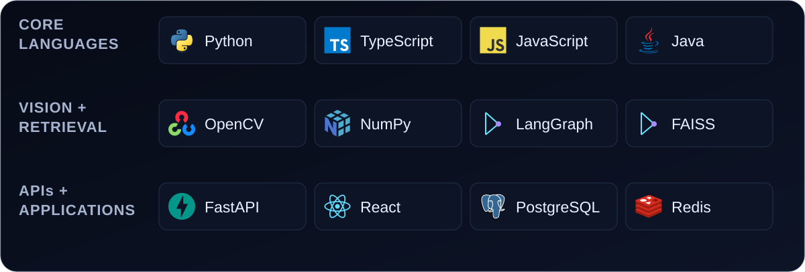
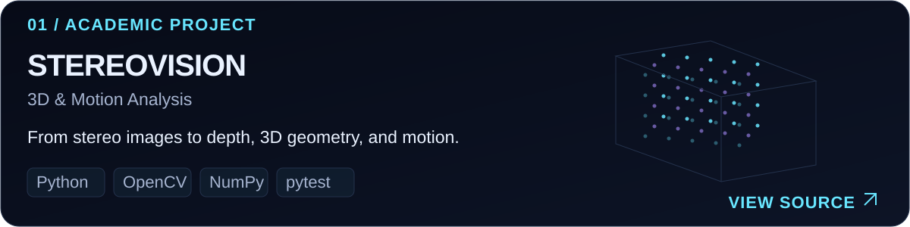
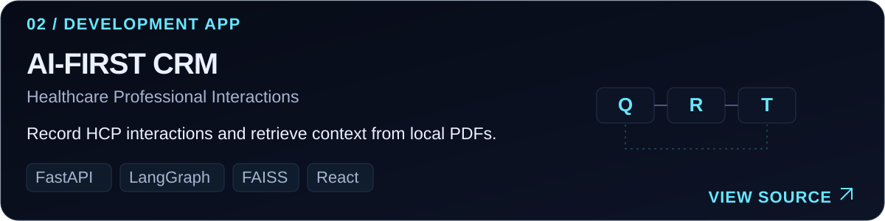
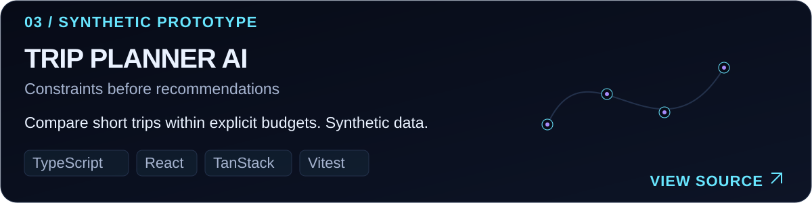
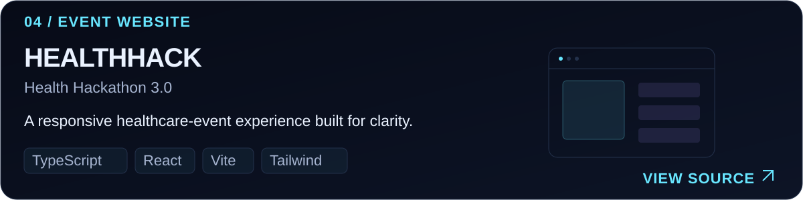
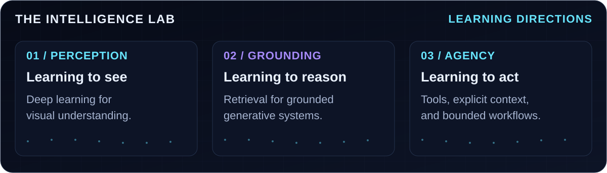
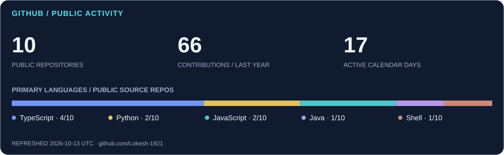
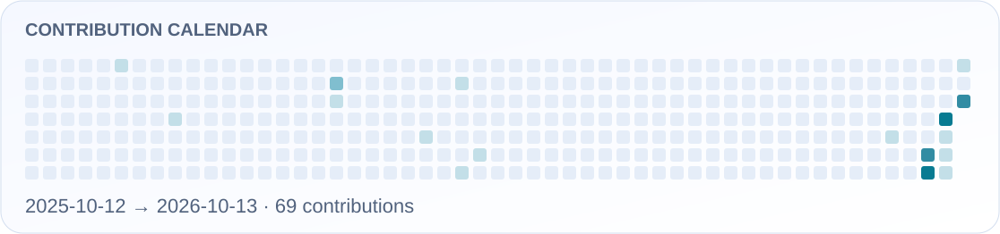

<picture>
  <source media="(max-width: 900px) and (prefers-reduced-motion: reduce) and (prefers-color-scheme: dark)" srcset="assets/brand/hero-mobile-static-dark.svg">
  <source media="(max-width: 900px) and (prefers-reduced-motion: reduce) and (prefers-color-scheme: light)" srcset="assets/brand/hero-mobile-static-light.svg">
  <source media="(prefers-reduced-motion: reduce) and (prefers-color-scheme: dark)" srcset="assets/brand/hero-static-dark.svg">
  <source media="(prefers-reduced-motion: reduce) and (prefers-color-scheme: light)" srcset="assets/brand/hero-static-light.svg">
  <source media="(max-width: 900px) and (prefers-color-scheme: dark)" srcset="assets/brand/hero-mobile-dark.svg">
  <source media="(max-width: 900px) and (prefers-color-scheme: light)" srcset="assets/brand/hero-mobile-light.svg">
  <source media="(prefers-color-scheme: dark)" srcset="assets/brand/hero-dark.svg">
  <source media="(prefers-color-scheme: light)" srcset="assets/brand/hero-light.svg">
  
</picture>

  <picture>
    <source media="(max-width: 900px) and (prefers-reduced-motion: reduce) and (prefers-color-scheme: dark)" srcset="assets/brand/intro-mobile-static-dark.svg">
    <source media="(max-width: 900px) and (prefers-reduced-motion: reduce) and (prefers-color-scheme: light)" srcset="assets/brand/intro-mobile-static-light.svg">
    <source media="(prefers-reduced-motion: reduce) and (prefers-color-scheme: dark)" srcset="assets/brand/intro-static-dark.svg">
    <source media="(prefers-reduced-motion: reduce) and (prefers-color-scheme: light)" srcset="assets/brand/intro-static-light.svg">
    <source media="(max-width: 900px) and (prefers-color-scheme: dark)" srcset="assets/brand/intro-mobile-dark.svg">
    <source media="(max-width: 900px) and (prefers-color-scheme: light)" srcset="assets/brand/intro-mobile-light.svg">
    <source media="(prefers-color-scheme: dark)" srcset="assets/brand/intro-dark.svg">
    <source media="(prefers-color-scheme: light)" srcset="assets/brand/intro-light.svg">
    
  </picture>

  
  &nbsp;
  

## 01 / THE ENGINEER BEHIND THE CODE

I'm **Lokesh**, a Computer Science student specializing in **AI & ML**, with **Python** at the center of my work. I'm focused on learning to build intelligent systems and useful software, with a growing interest in **generative AI**.

My projects explore AI-assisted healthcare workflows, document retrieval, and interfaces that make complex information easier to use. I'm developing my foundations in machine learning and exploring generative AI and agentic systems. I also explore computer vision through stereo geometry and motion analysis.

~~~python
class Lokesh:
    language = "Python"
    focus = "AI / ML / GenAI"
    loop = "Build. Test. Refine."
~~~

Away from the keyboard: photography, gaming, and noticing how things work.

## 02 / THE TECHNICAL TOOLKIT

<picture>
  <source media="(max-width: 900px) and (prefers-color-scheme: dark)" srcset="assets/brand/stack-mobile-dark.svg">
  <source media="(max-width: 900px) and (prefers-color-scheme: light)" srcset="assets/brand/stack-mobile-light.svg">
  <source media="(prefers-color-scheme: dark)" srcset="assets/brand/stack-dark.svg">
  <source media="(prefers-color-scheme: light)" srcset="assets/brand/stack-light.svg">
  
</picture>

| Applied in the work | Where it shows up |
| :--- | :--- |
| **Vision & numerical computing** | OpenCV, NumPy, SciPy, Matplotlib — stereo depth, features, and optical flow |
| **AI orchestration & retrieval** | LangGraph, LangChain, FAISS, BM25, Groq, Google GenAI — tools and document context |
| **Applications & data** | React, TypeScript, JavaScript, Tailwind CSS, FastAPI, PostgreSQL, SQLAlchemy, Redis |
| **Development & validation** | Git, Vite, pytest, Vitest; Java Swing in the airline-management project |

These are tools present in my implemented work. My learning directions are collected in the Intelligence Lab below.

## 03 / SELECTED ENGINEERING

<a href="https://github.com/Lokesh-1921/CV-Project-1">
  <picture>
    <source media="(max-width: 900px) and (prefers-color-scheme: dark)" srcset="assets/project-cards/vision-mobile-dark.svg">
    <source media="(max-width: 900px) and (prefers-color-scheme: light)" srcset="assets/project-cards/vision-mobile-light.svg">
    <source media="(prefers-color-scheme: dark)" srcset="assets/project-cards/vision-dark.svg">
    <source media="(prefers-color-scheme: light)" srcset="assets/project-cards/vision-light.svg">
    
  </picture>
</a>

**[StereoVision · 3D & Motion Analysis](https://github.com/Lokesh-1921/CV-Project-1)** 
A Python CLI suite for stereo disparity, colored <code>.ply</code> point clouds, Harris/SIFT/ORB matching with RANSAC, and Farnebäck/Lucas–Kanade optical flow. Includes synthetic datasets, evaluation metrics, and unit/integration tests.

<a href="https://github.com/Lokesh-1921/DigiLocker-For-Hospitals">
  <picture>
    <source media="(max-width: 900px) and (prefers-color-scheme: dark)" srcset="assets/project-cards/crm-mobile-dark.svg">
    <source media="(max-width: 900px) and (prefers-color-scheme: light)" srcset="assets/project-cards/crm-mobile-light.svg">
    <source media="(prefers-color-scheme: dark)" srcset="assets/project-cards/crm-dark.svg">
    <source media="(prefers-color-scheme: light)" srcset="assets/project-cards/crm-light.svg">
    
  </picture>
</a>

**[AI-First CRM · Healthcare Professional Interactions](https://github.com/Lokesh-1921/DigiLocker-For-Hospitals)** 
A React/FastAPI CRM with LangGraph intent routing, FAISS + BM25 hybrid retrieval, and model-based reranking over local PDFs. Implements PostgreSQL persistence, Redis caching, and dashboard updates. Its README documents development and integration limitations.

<a href="https://github.com/Lokesh-1921/trip-planner-ai">
  <picture>
    <source media="(max-width: 900px) and (prefers-color-scheme: dark)" srcset="assets/project-cards/trip-mobile-dark.svg">
    <source media="(max-width: 900px) and (prefers-color-scheme: light)" srcset="assets/project-cards/trip-mobile-light.svg">
    <source media="(prefers-color-scheme: dark)" srcset="assets/project-cards/trip-dark.svg">
    <source media="(prefers-color-scheme: light)" srcset="assets/project-cards/trip-light.svg">
    
  </picture>
</a>

**[Trip Planner AI](https://github.com/Lokesh-1921/trip-planner-ai)** 
A synthetic travel-planning prototype with editable trip details, deterministic filtering/ranking, and transparent flight/hotel cost breakdowns. Includes assistant integration code and tests; AI availability depends on backend configuration. Selections are simulations.

<a href="https://github.com/Lokesh-1921/HealthHACK">
  <picture>
    <source media="(max-width: 900px) and (prefers-color-scheme: dark)" srcset="assets/project-cards/health-mobile-dark.svg">
    <source media="(max-width: 900px) and (prefers-color-scheme: light)" srcset="assets/project-cards/health-mobile-light.svg">
    <source media="(prefers-color-scheme: dark)" srcset="assets/project-cards/health-dark.svg">
    <source media="(prefers-color-scheme: light)" srcset="assets/project-cards/health-light.svg">
    
  </picture>
</a>

**[HealthHACK · Health Hackathon 3.0](https://github.com/Lokesh-1921/HealthHACK)** 
A responsive healthcare-event website with typed content modules, a keyboard-accessible gallery lightbox, an event timeline, and reduced-motion support.

[Explore the complete repository collection ↗](https://github.com/Lokesh-1921?tab=repositories)

## 04 / THE INTELLIGENCE LAB

<picture>
  <source media="(max-width: 900px) and (prefers-color-scheme: dark)" srcset="assets/brand/lab-mobile-dark.svg">
  <source media="(max-width: 900px) and (prefers-color-scheme: light)" srcset="assets/brand/lab-mobile-light.svg">
  <source media="(prefers-color-scheme: dark)" srcset="assets/brand/lab-dark.svg">
  <source media="(prefers-color-scheme: light)" srcset="assets/brand/lab-light.svg">
  
</picture>

I'm exploring **grounded generative AI** and **agent workflows with explicit context and tool boundaries**, alongside a secondary interest in deep learning for visual understanding. These learning directions connect to my retrieval and vision projects.

## 05 / ENGINEERING SIGNAL

<picture>
  <source media="(max-width: 900px) and (prefers-color-scheme: dark)" srcset="assets/live/dashboard-mobile-dark.svg">
  <source media="(max-width: 900px) and (prefers-color-scheme: light)" srcset="assets/live/dashboard-mobile-light.svg">
  <source media="(prefers-color-scheme: dark)" srcset="assets/live/dashboard-dark.svg">
  <source media="(prefers-color-scheme: light)" srcset="assets/live/dashboard-light.svg">
  
</picture>

Daily public-data snapshot. Language shares count non-fork project repositories by primary language and exclude this profile repository; they do not measure code volume or proficiency. Failed refreshes retain the last successful images.

### THE CONTRIBUTION TRACE

<picture>
  <source media="(max-width: 900px) and (prefers-reduced-motion: reduce) and (prefers-color-scheme: dark)" srcset="assets/live/contributions-mobile-dark.svg">
  <source media="(max-width: 900px) and (prefers-reduced-motion: reduce) and (prefers-color-scheme: light)" srcset="assets/live/contributions-mobile-light.svg">
  <source media="(prefers-reduced-motion: reduce) and (prefers-color-scheme: dark)" srcset="assets/live/contributions-dark.svg">
  <source media="(prefers-reduced-motion: reduce) and (prefers-color-scheme: light)" srcset="assets/live/contributions-light.svg">
  <source media="(prefers-color-scheme: dark)" srcset="assets/live/snake-dark.svg">
  <source media="(prefers-color-scheme: light)" srcset="assets/live/snake-light.svg">
  
</picture>

  
Open the static contribution calendar

   
  <picture>
    <source media="(max-width: 900px) and (prefers-color-scheme: dark)" srcset="assets/live/contributions-mobile-dark.svg">
    <source media="(max-width: 900px) and (prefers-color-scheme: light)" srcset="assets/live/contributions-mobile-light.svg">
    <source media="(prefers-color-scheme: dark)" srcset="assets/live/contributions-dark.svg">
    <source media="(prefers-color-scheme: light)" srcset="assets/live/contributions-light.svg">
    
  </picture>

[Inspect the current GitHub contribution history ↗](https://github.com/Lokesh-1921)

## 06 / BUILD WITH INTENT

I'm interested in AI/ML collaborations, generative AI projects, and software that makes a real problem easier to solve.

**[Connect on LinkedIn](https://www.linkedin.com/in/lokesh-ks/)** · **[Explore the source](https://github.com/Lokesh-1921?tab=repositories)**

<picture>
  <source media="(max-width: 900px) and (prefers-reduced-motion: reduce) and (prefers-color-scheme: dark)" srcset="assets/brand/footer-mobile-static-dark.svg">
  <source media="(max-width: 900px) and (prefers-reduced-motion: reduce) and (prefers-color-scheme: light)" srcset="assets/brand/footer-mobile-static-light.svg">
  <source media="(prefers-reduced-motion: reduce) and (prefers-color-scheme: dark)" srcset="assets/brand/footer-static-dark.svg">
  <source media="(prefers-reduced-motion: reduce) and (prefers-color-scheme: light)" srcset="assets/brand/footer-static-light.svg">
  <source media="(max-width: 900px) and (prefers-color-scheme: dark)" srcset="assets/brand/footer-mobile-dark.svg">
  <source media="(max-width: 900px) and (prefers-color-scheme: light)" srcset="assets/brand/footer-mobile-light.svg">
  <source media="(prefers-color-scheme: dark)" srcset="assets/brand/footer-dark.svg">
  <source media="(prefers-color-scheme: light)" srcset="assets/brand/footer-light.svg">
  
</picture>
