<!-- Generated by scripts/build_readme.py. Edit content/profile.json and the design modules. -->

<picture>
  <source media="(max-width: 900px) and (prefers-reduced-motion: reduce) and (prefers-color-scheme: dark)" srcset="assets/hero/hero-mobile-static-dark.svg">
  <source media="(max-width: 900px) and (prefers-reduced-motion: reduce) and (prefers-color-scheme: light)" srcset="assets/hero/hero-mobile-static-light.svg">
  <source media="(prefers-reduced-motion: reduce) and (prefers-color-scheme: dark)" srcset="assets/hero/hero-static-dark.svg">
  <source media="(prefers-reduced-motion: reduce) and (prefers-color-scheme: light)" srcset="assets/hero/hero-static-light.svg">
  <source media="(max-width: 900px) and (prefers-color-scheme: dark)" srcset="assets/hero/hero-mobile-dark.svg">
  <source media="(max-width: 900px) and (prefers-color-scheme: light)" srcset="assets/hero/hero-mobile-light.svg">
  <source media="(prefers-color-scheme: dark)" srcset="assets/hero/hero-dark.svg">
  <source media="(prefers-color-scheme: light)" srcset="assets/hero/hero-light.svg">
  
</picture>

<picture>
  <source media="(max-width: 900px) and (prefers-reduced-motion: reduce) and (prefers-color-scheme: dark)" srcset="assets/modules/role-strip-mobile-static-dark.svg">
  <source media="(max-width: 900px) and (prefers-reduced-motion: reduce) and (prefers-color-scheme: light)" srcset="assets/modules/role-strip-mobile-static-light.svg">
  <source media="(prefers-reduced-motion: reduce) and (prefers-color-scheme: dark)" srcset="assets/modules/role-strip-static-dark.svg">
  <source media="(prefers-reduced-motion: reduce) and (prefers-color-scheme: light)" srcset="assets/modules/role-strip-static-light.svg">
  <source media="(max-width: 900px) and (prefers-color-scheme: dark)" srcset="assets/modules/role-strip-mobile-dark.svg">
  <source media="(max-width: 900px) and (prefers-color-scheme: light)" srcset="assets/modules/role-strip-mobile-light.svg">
  <source media="(prefers-color-scheme: dark)" srcset="assets/modules/role-strip-dark.svg">
  <source media="(prefers-color-scheme: light)" srcset="assets/modules/role-strip-light.svg">
  
</picture>

  
  &nbsp;
  

<h2>
<picture>
  <source media="(max-width: 900px) and (prefers-reduced-motion: reduce) and (prefers-color-scheme: dark)" srcset="assets/modules/section-01-about-mobile-static-dark.svg">
  <source media="(max-width: 900px) and (prefers-reduced-motion: reduce) and (prefers-color-scheme: light)" srcset="assets/modules/section-01-about-mobile-static-light.svg">
  <source media="(prefers-reduced-motion: reduce) and (prefers-color-scheme: dark)" srcset="assets/modules/section-01-about-static-dark.svg">
  <source media="(prefers-reduced-motion: reduce) and (prefers-color-scheme: light)" srcset="assets/modules/section-01-about-static-light.svg">
  <source media="(max-width: 900px) and (prefers-color-scheme: dark)" srcset="assets/modules/section-01-about-mobile-dark.svg">
  <source media="(max-width: 900px) and (prefers-color-scheme: light)" srcset="assets/modules/section-01-about-mobile-light.svg">
  <source media="(prefers-color-scheme: dark)" srcset="assets/modules/section-01-about-dark.svg">
  <source media="(prefers-color-scheme: light)" srcset="assets/modules/section-01-about-light.svg">
  
</picture>
</h2>

I'm **Lokesh**, a Computer Science student specializing in **AI & ML**. Python is at the center of my work, and I'm learning to build intelligent systems that turn ideas into useful software.

My public projects explore document retrieval, AI-assisted healthcare workflows, and thoughtful application interfaces. I'm developing my machine learning foundations while exploring **generative AI** and **agentic systems**.

~~~python
class Lokesh:
    language = "Python"
    focus = "AI / ML / GenAI"
    loop = "Build. Test. Refine."
~~~

Away from the keyboard: photography, gaming, and noticing how things work.

<h2>
<picture>
  <source media="(max-width: 900px) and (prefers-reduced-motion: reduce) and (prefers-color-scheme: dark)" srcset="assets/modules/section-02-systems-mobile-static-dark.svg">
  <source media="(max-width: 900px) and (prefers-reduced-motion: reduce) and (prefers-color-scheme: light)" srcset="assets/modules/section-02-systems-mobile-static-light.svg">
  <source media="(prefers-reduced-motion: reduce) and (prefers-color-scheme: dark)" srcset="assets/modules/section-02-systems-static-dark.svg">
  <source media="(prefers-reduced-motion: reduce) and (prefers-color-scheme: light)" srcset="assets/modules/section-02-systems-static-light.svg">
  <source media="(max-width: 900px) and (prefers-color-scheme: dark)" srcset="assets/modules/section-02-systems-mobile-dark.svg">
  <source media="(max-width: 900px) and (prefers-color-scheme: light)" srcset="assets/modules/section-02-systems-mobile-light.svg">
  <source media="(prefers-color-scheme: dark)" srcset="assets/modules/section-02-systems-dark.svg">
  <source media="(prefers-color-scheme: light)" srcset="assets/modules/section-02-systems-light.svg">
  
</picture>
</h2>

<picture>
  <source media="(max-width: 900px) and (prefers-reduced-motion: reduce) and (prefers-color-scheme: dark)" srcset="assets/dashboards/technical-systems-mobile-static-dark.svg">
  <source media="(max-width: 900px) and (prefers-reduced-motion: reduce) and (prefers-color-scheme: light)" srcset="assets/dashboards/technical-systems-mobile-static-light.svg">
  <source media="(prefers-reduced-motion: reduce) and (prefers-color-scheme: dark)" srcset="assets/dashboards/technical-systems-static-dark.svg">
  <source media="(prefers-reduced-motion: reduce) and (prefers-color-scheme: light)" srcset="assets/dashboards/technical-systems-static-light.svg">
  <source media="(max-width: 900px) and (prefers-color-scheme: dark)" srcset="assets/dashboards/technical-systems-mobile-dark.svg">
  <source media="(max-width: 900px) and (prefers-color-scheme: light)" srcset="assets/dashboards/technical-systems-mobile-light.svg">
  <source media="(prefers-color-scheme: dark)" srcset="assets/dashboards/technical-systems-dark.svg">
  <source media="(prefers-color-scheme: light)" srcset="assets/dashboards/technical-systems-light.svg">
  
</picture>

These tools appear in my implemented public projects. The healthcare CRM also uses Groq and Google GenAI integrations. **Learning directions** are shown separately below.

<h2>
<picture>
  <source media="(max-width: 900px) and (prefers-reduced-motion: reduce) and (prefers-color-scheme: dark)" srcset="assets/modules/section-03-builds-mobile-static-dark.svg">
  <source media="(max-width: 900px) and (prefers-reduced-motion: reduce) and (prefers-color-scheme: light)" srcset="assets/modules/section-03-builds-mobile-static-light.svg">
  <source media="(prefers-reduced-motion: reduce) and (prefers-color-scheme: dark)" srcset="assets/modules/section-03-builds-static-dark.svg">
  <source media="(prefers-reduced-motion: reduce) and (prefers-color-scheme: light)" srcset="assets/modules/section-03-builds-static-light.svg">
  <source media="(max-width: 900px) and (prefers-color-scheme: dark)" srcset="assets/modules/section-03-builds-mobile-dark.svg">
  <source media="(max-width: 900px) and (prefers-color-scheme: light)" srcset="assets/modules/section-03-builds-mobile-light.svg">
  <source media="(prefers-color-scheme: dark)" srcset="assets/modules/section-03-builds-dark.svg">
  <source media="(prefers-color-scheme: light)" srcset="assets/modules/section-03-builds-light.svg">
  
</picture>
</h2>

<a href="https://github.com/Lokesh-1921/DigiLocker-For-Hospitals">
<picture>
  <source media="(max-width: 900px) and (prefers-reduced-motion: reduce) and (prefers-color-scheme: dark)" srcset="assets/projects/crm-mobile-static-dark.svg">
  <source media="(max-width: 900px) and (prefers-reduced-motion: reduce) and (prefers-color-scheme: light)" srcset="assets/projects/crm-mobile-static-light.svg">
  <source media="(prefers-reduced-motion: reduce) and (prefers-color-scheme: dark)" srcset="assets/projects/crm-static-dark.svg">
  <source media="(prefers-reduced-motion: reduce) and (prefers-color-scheme: light)" srcset="assets/projects/crm-static-light.svg">
  <source media="(max-width: 900px) and (prefers-color-scheme: dark)" srcset="assets/projects/crm-mobile-dark.svg">
  <source media="(max-width: 900px) and (prefers-color-scheme: light)" srcset="assets/projects/crm-mobile-light.svg">
  <source media="(prefers-color-scheme: dark)" srcset="assets/projects/crm-dark.svg">
  <source media="(prefers-color-scheme: light)" srcset="assets/projects/crm-light.svg">
  
</picture>
</a>

**[AI-First CRM](https://github.com/Lokesh-1921/DigiLocker-For-Hospitals)** 
A React/FastAPI CRM with LangGraph intent routing, FAISS + BM25 hybrid retrieval, and model-based reranking over local PDFs. Includes PostgreSQL persistence, Redis caching, and dashboard updates. Its repository documents development and integration limitations.

<a href="https://github.com/Lokesh-1921/trip-planner-ai">
<picture>
  <source media="(max-width: 900px) and (prefers-reduced-motion: reduce) and (prefers-color-scheme: dark)" srcset="assets/projects/trip-mobile-static-dark.svg">
  <source media="(max-width: 900px) and (prefers-reduced-motion: reduce) and (prefers-color-scheme: light)" srcset="assets/projects/trip-mobile-static-light.svg">
  <source media="(prefers-reduced-motion: reduce) and (prefers-color-scheme: dark)" srcset="assets/projects/trip-static-dark.svg">
  <source media="(prefers-reduced-motion: reduce) and (prefers-color-scheme: light)" srcset="assets/projects/trip-static-light.svg">
  <source media="(max-width: 900px) and (prefers-color-scheme: dark)" srcset="assets/projects/trip-mobile-dark.svg">
  <source media="(max-width: 900px) and (prefers-color-scheme: light)" srcset="assets/projects/trip-mobile-light.svg">
  <source media="(prefers-color-scheme: dark)" srcset="assets/projects/trip-dark.svg">
  <source media="(prefers-color-scheme: light)" srcset="assets/projects/trip-light.svg">
  
</picture>
</a>

**[Trip Planner AI](https://github.com/Lokesh-1921/trip-planner-ai)** 
A synthetic travel-planning prototype with editable trip details, deterministic filtering/ranking, and transparent flight/hotel cost breakdowns. Includes assistant integration code and tests; AI availability depends on backend configuration. Selections are simulations.

<a href="https://github.com/Lokesh-1921/HealthHACK">
<picture>
  <source media="(max-width: 900px) and (prefers-reduced-motion: reduce) and (prefers-color-scheme: dark)" srcset="assets/projects/health-mobile-static-dark.svg">
  <source media="(max-width: 900px) and (prefers-reduced-motion: reduce) and (prefers-color-scheme: light)" srcset="assets/projects/health-mobile-static-light.svg">
  <source media="(prefers-reduced-motion: reduce) and (prefers-color-scheme: dark)" srcset="assets/projects/health-static-dark.svg">
  <source media="(prefers-reduced-motion: reduce) and (prefers-color-scheme: light)" srcset="assets/projects/health-static-light.svg">
  <source media="(max-width: 900px) and (prefers-color-scheme: dark)" srcset="assets/projects/health-mobile-dark.svg">
  <source media="(max-width: 900px) and (prefers-color-scheme: light)" srcset="assets/projects/health-mobile-light.svg">
  <source media="(prefers-color-scheme: dark)" srcset="assets/projects/health-dark.svg">
  <source media="(prefers-color-scheme: light)" srcset="assets/projects/health-light.svg">
  
</picture>
</a>

**[HealthHACK](https://github.com/Lokesh-1921/HealthHACK)** 
A responsive healthcare-event website with typed content modules, a keyboard-accessible gallery lightbox, an event timeline, and reduced-motion support.

<a href="https://github.com/Lokesh-1921/CV-Project-1">
<picture>
  <source media="(max-width: 900px) and (prefers-reduced-motion: reduce) and (prefers-color-scheme: dark)" srcset="assets/projects/vision-mobile-static-dark.svg">
  <source media="(max-width: 900px) and (prefers-reduced-motion: reduce) and (prefers-color-scheme: light)" srcset="assets/projects/vision-mobile-static-light.svg">
  <source media="(prefers-reduced-motion: reduce) and (prefers-color-scheme: dark)" srcset="assets/projects/vision-static-dark.svg">
  <source media="(prefers-reduced-motion: reduce) and (prefers-color-scheme: light)" srcset="assets/projects/vision-static-light.svg">
  <source media="(max-width: 900px) and (prefers-color-scheme: dark)" srcset="assets/projects/vision-mobile-dark.svg">
  <source media="(max-width: 900px) and (prefers-color-scheme: light)" srcset="assets/projects/vision-mobile-light.svg">
  <source media="(prefers-color-scheme: dark)" srcset="assets/projects/vision-dark.svg">
  <source media="(prefers-color-scheme: light)" srcset="assets/projects/vision-light.svg">
  
</picture>
</a>

**[StereoVision · 3D & Motion Analysis](https://github.com/Lokesh-1921/CV-Project-1)** 
A Python CLI suite for stereo disparity, colored .ply point clouds, Harris/SIFT/ORB matching with RANSAC, and Farnebäck/Lucas–Kanade optical flow. Includes synthetic datasets, evaluation metrics, and unit/integration tests. Computer vision is a secondary exploration.

[Explore the complete repository collection ↗](https://github.com/Lokesh-1921?tab=repositories)

<h2>
<picture>
  <source media="(max-width: 900px) and (prefers-reduced-motion: reduce) and (prefers-color-scheme: dark)" srcset="assets/modules/section-04-dashboard-mobile-static-dark.svg">
  <source media="(max-width: 900px) and (prefers-reduced-motion: reduce) and (prefers-color-scheme: light)" srcset="assets/modules/section-04-dashboard-mobile-static-light.svg">
  <source media="(prefers-reduced-motion: reduce) and (prefers-color-scheme: dark)" srcset="assets/modules/section-04-dashboard-static-dark.svg">
  <source media="(prefers-reduced-motion: reduce) and (prefers-color-scheme: light)" srcset="assets/modules/section-04-dashboard-static-light.svg">
  <source media="(max-width: 900px) and (prefers-color-scheme: dark)" srcset="assets/modules/section-04-dashboard-mobile-dark.svg">
  <source media="(max-width: 900px) and (prefers-color-scheme: light)" srcset="assets/modules/section-04-dashboard-mobile-light.svg">
  <source media="(prefers-color-scheme: dark)" srcset="assets/modules/section-04-dashboard-dark.svg">
  <source media="(prefers-color-scheme: light)" srcset="assets/modules/section-04-dashboard-light.svg">
  
</picture>
</h2>

<picture>
  <source media="(max-width: 900px) and (prefers-reduced-motion: reduce) and (prefers-color-scheme: dark)" srcset="assets/generated/stats-summary-mobile-static-dark.svg">
  <source media="(max-width: 900px) and (prefers-reduced-motion: reduce) and (prefers-color-scheme: light)" srcset="assets/generated/stats-summary-mobile-static-light.svg">
  <source media="(prefers-reduced-motion: reduce) and (prefers-color-scheme: dark)" srcset="assets/generated/stats-summary-static-dark.svg">
  <source media="(prefers-reduced-motion: reduce) and (prefers-color-scheme: light)" srcset="assets/generated/stats-summary-static-light.svg">
  <source media="(max-width: 900px) and (prefers-color-scheme: dark)" srcset="assets/generated/stats-summary-mobile-dark.svg">
  <source media="(max-width: 900px) and (prefers-color-scheme: light)" srcset="assets/generated/stats-summary-mobile-light.svg">
  <source media="(prefers-color-scheme: dark)" srcset="assets/generated/stats-summary-dark.svg">
  <source media="(prefers-color-scheme: light)" srcset="assets/generated/stats-summary-light.svg">
  
</picture>

Daily public-data snapshot. Language shares count non-fork project repositories by primary language and exclude this profile; they do not measure code volume or proficiency. Failed refreshes retain the last verified images.

### THE CONTRIBUTION TRACE

<picture>
  <source media="(max-width: 900px) and (prefers-reduced-motion: reduce) and (prefers-color-scheme: dark)" srcset="assets/generated/activity-calendar-mobile-dark.svg">
  <source media="(max-width: 900px) and (prefers-reduced-motion: reduce) and (prefers-color-scheme: light)" srcset="assets/generated/activity-calendar-mobile-light.svg">
  <source media="(prefers-reduced-motion: reduce) and (prefers-color-scheme: dark)" srcset="assets/generated/activity-calendar-dark.svg">
  <source media="(prefers-reduced-motion: reduce) and (prefers-color-scheme: light)" srcset="assets/generated/activity-calendar-light.svg">
  <source media="(prefers-color-scheme: dark)" srcset="assets/generated/contribution-snake-dark.svg">
  <source media="(prefers-color-scheme: light)" srcset="assets/generated/contribution-snake-light.svg">
  
</picture>

  
Open the static contribution calendar

   
<picture>
  <source media="(max-width: 900px) and (prefers-color-scheme: dark)" srcset="assets/generated/activity-calendar-mobile-dark.svg">
  <source media="(max-width: 900px) and (prefers-color-scheme: light)" srcset="assets/generated/activity-calendar-mobile-light.svg">
  <source media="(prefers-color-scheme: dark)" srcset="assets/generated/activity-calendar-dark.svg">
  <source media="(prefers-color-scheme: light)" srcset="assets/generated/activity-calendar-light.svg">
  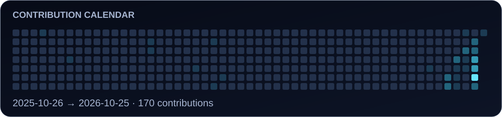
</picture>

[Inspect the current GitHub contribution history ↗](https://github.com/Lokesh-1921)

<h2>
<picture>
  <source media="(max-width: 900px) and (prefers-reduced-motion: reduce) and (prefers-color-scheme: dark)" srcset="assets/modules/section-05-exploring-mobile-static-dark.svg">
  <source media="(max-width: 900px) and (prefers-reduced-motion: reduce) and (prefers-color-scheme: light)" srcset="assets/modules/section-05-exploring-mobile-static-light.svg">
  <source media="(prefers-reduced-motion: reduce) and (prefers-color-scheme: dark)" srcset="assets/modules/section-05-exploring-static-dark.svg">
  <source media="(prefers-reduced-motion: reduce) and (prefers-color-scheme: light)" srcset="assets/modules/section-05-exploring-static-light.svg">
  <source media="(max-width: 900px) and (prefers-color-scheme: dark)" srcset="assets/modules/section-05-exploring-mobile-dark.svg">
  <source media="(max-width: 900px) and (prefers-color-scheme: light)" srcset="assets/modules/section-05-exploring-mobile-light.svg">
  <source media="(prefers-color-scheme: dark)" srcset="assets/modules/section-05-exploring-dark.svg">
  <source media="(prefers-color-scheme: light)" srcset="assets/modules/section-05-exploring-light.svg">
  
</picture>
</h2>

<picture>
  <source media="(max-width: 900px) and (prefers-reduced-motion: reduce) and (prefers-color-scheme: dark)" srcset="assets/modules/currently-exploring-mobile-static-dark.svg">
  <source media="(max-width: 900px) and (prefers-reduced-motion: reduce) and (prefers-color-scheme: light)" srcset="assets/modules/currently-exploring-mobile-static-light.svg">
  <source media="(prefers-reduced-motion: reduce) and (prefers-color-scheme: dark)" srcset="assets/modules/currently-exploring-static-dark.svg">
  <source media="(prefers-reduced-motion: reduce) and (prefers-color-scheme: light)" srcset="assets/modules/currently-exploring-static-light.svg">
  <source media="(max-width: 900px) and (prefers-color-scheme: dark)" srcset="assets/modules/currently-exploring-mobile-dark.svg">
  <source media="(max-width: 900px) and (prefers-color-scheme: light)" srcset="assets/modules/currently-exploring-mobile-light.svg">
  <source media="(prefers-color-scheme: dark)" srcset="assets/modules/currently-exploring-dark.svg">
  <source media="(prefers-color-scheme: light)" srcset="assets/modules/currently-exploring-light.svg">
  
</picture>

I'm exploring **machine learning foundations**, **grounded generative AI**, and **agent workflows with explicit context and tool boundaries**. Computer vision remains a side exploration, supported by my stereo/motion project.

<h2>
<picture>
  <source media="(max-width: 900px) and (prefers-reduced-motion: reduce) and (prefers-color-scheme: dark)" srcset="assets/modules/section-06-closing-mobile-static-dark.svg">
  <source media="(max-width: 900px) and (prefers-reduced-motion: reduce) and (prefers-color-scheme: light)" srcset="assets/modules/section-06-closing-mobile-static-light.svg">
  <source media="(prefers-reduced-motion: reduce) and (prefers-color-scheme: dark)" srcset="assets/modules/section-06-closing-static-dark.svg">
  <source media="(prefers-reduced-motion: reduce) and (prefers-color-scheme: light)" srcset="assets/modules/section-06-closing-static-light.svg">
  <source media="(max-width: 900px) and (prefers-color-scheme: dark)" srcset="assets/modules/section-06-closing-mobile-dark.svg">
  <source media="(max-width: 900px) and (prefers-color-scheme: light)" srcset="assets/modules/section-06-closing-mobile-light.svg">
  <source media="(prefers-color-scheme: dark)" srcset="assets/modules/section-06-closing-dark.svg">
  <source media="(prefers-color-scheme: light)" srcset="assets/modules/section-06-closing-light.svg">
  
</picture>
</h2>

I'm interested in AI/ML collaborations, generative AI projects, and software that makes a real problem easier to solve.

**[Connect on LinkedIn](https://www.linkedin.com/in/lokesh-ks/)** · **[Explore the source](https://github.com/Lokesh-1921?tab=repositories)**

<picture>
  <source media="(max-width: 900px) and (prefers-reduced-motion: reduce) and (prefers-color-scheme: dark)" srcset="assets/modules/closing-banner-mobile-static-dark.svg">
  <source media="(max-width: 900px) and (prefers-reduced-motion: reduce) and (prefers-color-scheme: light)" srcset="assets/modules/closing-banner-mobile-static-light.svg">
  <source media="(prefers-reduced-motion: reduce) and (prefers-color-scheme: dark)" srcset="assets/modules/closing-banner-static-dark.svg">
  <source media="(prefers-reduced-motion: reduce) and (prefers-color-scheme: light)" srcset="assets/modules/closing-banner-static-light.svg">
  <source media="(max-width: 900px) and (prefers-color-scheme: dark)" srcset="assets/modules/closing-banner-mobile-dark.svg">
  <source media="(max-width: 900px) and (prefers-color-scheme: light)" srcset="assets/modules/closing-banner-mobile-light.svg">
  <source media="(prefers-color-scheme: dark)" srcset="assets/modules/closing-banner-dark.svg">
  <source media="(prefers-color-scheme: light)" srcset="assets/modules/closing-banner-light.svg">
  
</picture>
