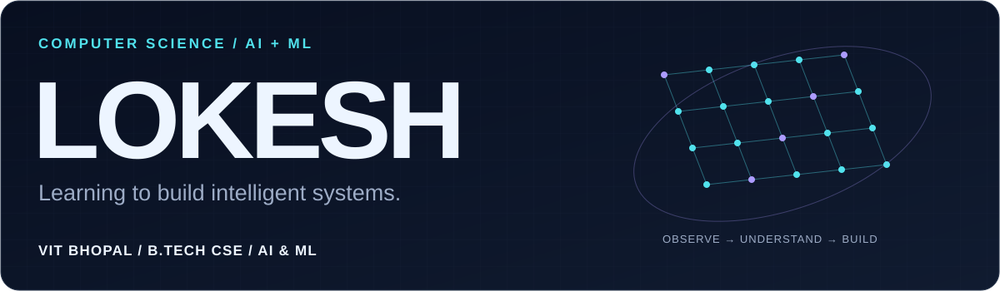
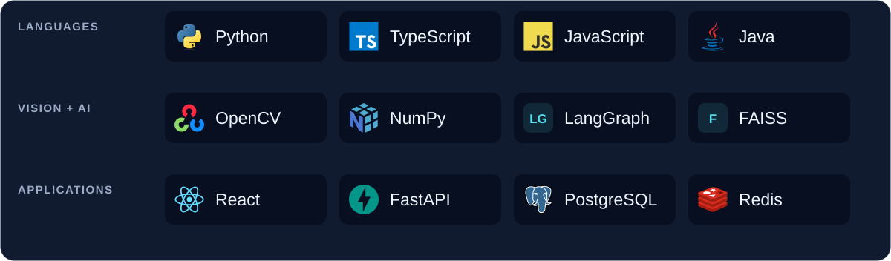
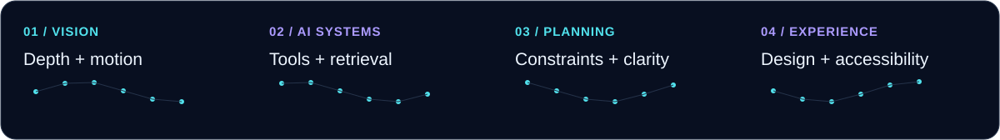
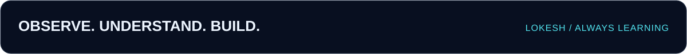

<picture>
  <source media="(max-width: 600px) and (prefers-color-scheme: dark)" srcset="assets/hero-mobile-dark.svg">
  <source media="(max-width: 600px) and (prefers-color-scheme: light)" srcset="assets/hero-mobile-light.svg">
  <source media="(prefers-color-scheme: dark)" srcset="assets/hero-dark.svg">
  <source media="(prefers-color-scheme: light)" srcset="assets/hero-light.svg">
  
</picture>

<p align="center">
  <picture>
    <source media="(max-width: 600px) and (prefers-color-scheme: dark)" srcset="assets/intro-mobile-dark.svg">
    <source media="(max-width: 600px) and (prefers-color-scheme: light)" srcset="assets/intro-mobile-light.svg">
    <source media="(prefers-color-scheme: dark)" srcset="assets/intro-dark.svg">
    <source media="(prefers-color-scheme: light)" srcset="assets/intro-light.svg">
    
  </picture>
</p>

<p align="center">
  <a href="https://www.linkedin.com/in/lokesh-ks/"></a>
  &nbsp;
  <a href="https://github.com/Lokesh-1921?tab=repositories"></a>
</p>

<p align="center"><b>From pixels to perception. From ideas to useful software.</b></p>

## 01 / The person behind the code

I'm **Lokesh**, a **B.Tech Computer Science student specializing in AI & ML at VIT Bhopal**. I'm working toward a career in AI engineering, with a particular interest in computer vision and the systems that turn models into useful applications.

```python
lokesh = {
    "foundation": "Computer Science · AI & ML",
    "primary_language": "Python",
    "building": ["stereo vision", "AI-assisted healthcare CRM", "web experiences"],
    "exploring": ["deep learning", "generative AI", "agentic AI"],
    "off_screen": ["photography", "gaming"],
}
```

My repositories span **classical computer vision**, **retrieval-augmented assistants**, and **full-stack interfaces**. I enjoy connecting the underlying engineering to a clear, usable experience.

## 02 / Tools behind the work

<picture>
  <source media="(max-width: 600px) and (prefers-color-scheme: dark)" srcset="assets/stack-mobile-dark.svg">
  <source media="(max-width: 600px) and (prefers-color-scheme: light)" srcset="assets/stack-mobile-light.svg">
  <source media="(prefers-color-scheme: dark)" srcset="assets/stack-dark.svg">
  <source media="(prefers-color-scheme: light)" srcset="assets/stack-light.svg">
  
</picture>

| Area | Used in my repositories |
| :--- | :--- |
| **Vision & numerical computing** | OpenCV · NumPy · SciPy · Matplotlib — stereo depth, feature matching, optical flow |
| **AI orchestration & retrieval** | LangGraph · LangChain · FAISS · BM25 · Groq · Google GenAI — CRM tools and document questions |
| **Interfaces & APIs** | React · TypeScript · JavaScript · Tailwind CSS · FastAPI · Java Swing |
| **Data & development** | PostgreSQL · SQLAlchemy · Redis · Git · pytest · Vitest · Vite |

**Currently exploring:** deep learning for visual understanding, grounded generative AI, and agent workflows. These are learning directions; the projects below show what I've implemented so far.

## 03 / Selected engineering

<picture>
  <source media="(max-width: 600px) and (prefers-color-scheme: dark)" srcset="assets/projects-mobile-dark.svg">
  <source media="(max-width: 600px) and (prefers-color-scheme: light)" srcset="assets/projects-mobile-light.svg">
  <source media="(prefers-color-scheme: dark)" srcset="assets/projects-dark.svg">
  <source media="(prefers-color-scheme: light)" srcset="assets/projects-light.svg">
  
</picture>

<!-- Project card -->

> ### [StereoVision · 3D & Motion Analysis](https://github.com/Lokesh-1921/CV-Project-1)
>
> **Recover depth, geometry, and motion from images.** A Python CLI suite for stereo disparity, calibrated 3D point-cloud export, feature matching, and optical flow.
>
> - Combines block/semi-global stereo matching, Harris/SIFT/ORB features, RANSAC, and Farnebäck/Lucas–Kanade flow.
> - Includes synthetic datasets, evaluation metrics, and unit/integration tests; exports colored `.ply` point clouds.
>
> `Python` `OpenCV` `NumPy` `SciPy` `pytest` · **Academic computer-vision project**

<!-- Project card -->

> ### [AI-First CRM · Healthcare Professional Interactions](https://github.com/Lokesh-1921/DigiLocker-For-Hospitals)
>
> **Turn field interactions and product documents into searchable context.** A React/FastAPI CRM with a LangGraph assistant for interaction records and document questions.
>
> - Routes intents to CRM tools; combines FAISS semantic retrieval with BM25 keyword search and model-based reranking.
> - Implements PostgreSQL persistence, dashboard analytics, Redis caching, and WebSocket updates.
>
> `Python` `FastAPI` `LangGraph` `FAISS` `React` `PostgreSQL` · **Development application; integration limitations documented in its README**

<!-- Project card -->

> ### [Trip Planner AI](https://github.com/Lokesh-1921/trip-planner-ai)
>
> **Compare short trips against an explicit budget.** A synthetic travel-planning prototype with editable trip details and transparent flight/hotel cost breakdowns.
>
> - Implements deterministic filtering/ranking, input validation, and explicit empty/error states.
> - Includes server-side assistant integration code and tests; AI availability depends on backend configuration. Selections are simulations.
>
> `TypeScript` `React` `TanStack` `Tailwind CSS` `Vitest` · **Synthetic prototype**

<!-- Project card -->

> ### [HealthHACK · Health Hackathon 3.0](https://github.com/Lokesh-1921/HealthHACK)
>
> **Make a healthcare innovation event easier to explore.** A responsive event website with tracks, an event timeline, registration information, and a photo gallery.
>
> - Builds keyboard-accessible interactions, a gallery lightbox, and motion with reduced-motion support.
> - Organizes event content into typed data modules and includes static deployment configuration.
>
> `TypeScript` `React` `Vite` `Tailwind CSS` · **Event website**

[Explore all repositories →](https://github.com/Lokesh-1921?tab=repositories)

## 04 / Work in motion

<picture>
  <source media="(max-width: 600px) and (prefers-color-scheme: dark)" srcset="assets/live/dashboard-mobile-dark.svg">
  <source media="(max-width: 600px) and (prefers-color-scheme: light)" srcset="assets/live/dashboard-mobile-light.svg">
  <source media="(prefers-color-scheme: dark)" srcset="assets/live/dashboard-dark.svg">
  <source media="(prefers-color-scheme: light)" srcset="assets/live/dashboard-light.svg">
  
</picture>

<sub>Public GitHub data, refreshed daily by this repository. Language shares count repositories by primary language, rather than lines of code or proficiency. The last successful images stay available if an update fails.</sub>

### A small trail of consistent effort

<picture>
  <source media="(prefers-color-scheme: dark)" srcset="assets/live/snake-dark.svg">
  <source media="(prefers-color-scheme: light)" srcset="assets/live/snake-light.svg">
  
</picture>

<details>
  <summary>Prefer a static view? Open the contribution calendar.</summary>
  <br>
  <picture>
    <source media="(prefers-color-scheme: dark)" srcset="assets/live/contributions-dark.svg">
    <source media="(prefers-color-scheme: light)" srcset="assets/live/contributions-light.svg">
    
  </picture>
</details>

[View the current contribution history on GitHub →](https://github.com/Lokesh-1921)

## 05 / Let's build something useful

I'm interested in **AI/ML projects, computer-vision experiments, and thoughtful software collaborations**. If you're working on a problem where those interests overlap, I'd like to connect.

**[Connect on LinkedIn](https://www.linkedin.com/in/lokesh-ks/)** · **[Explore my work](https://github.com/Lokesh-1921?tab=repositories)**

<picture>
  <source media="(max-width: 600px) and (prefers-color-scheme: dark)" srcset="assets/footer-mobile-dark.svg">
  <source media="(max-width: 600px) and (prefers-color-scheme: light)" srcset="assets/footer-mobile-light.svg">
  <source media="(prefers-color-scheme: dark)" srcset="assets/footer-dark.svg">
  <source media="(prefers-color-scheme: light)" srcset="assets/footer-light.svg">
  
</picture>
